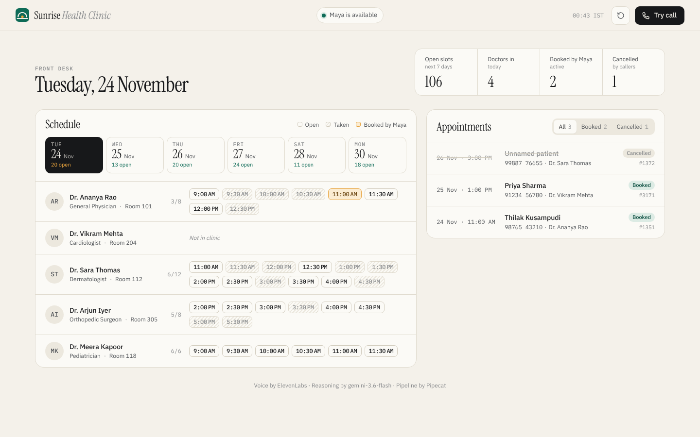

# Voice AI Doctor Appointment Assistant

A caller talks to **Maya**, the receptionist at a mock clinic. Maya can check a doctor's availability, book an appointment and cancel one. The caller is identified only by the mobile number they say during the call. A dashboard shows the call, the live transcript, every doctor's slots and the appointments list, and it updates as soon as Maya books or cancels something.



| | |
|---|---|
| Voice pipeline | [Pipecat](https://github.com/pipecat-ai/pipecat) 1.17 (Python) |
| Speech-to-text | ElevenLabs Scribe v2 Realtime (`ElevenLabsRealtimeSTTService`) |
| Text-to-speech | ElevenLabs Flash v2.5 (`ElevenLabsTTSService`) |
| **LLM** | **Google Gemini 3.5 Flash-Lite** (`gemini-3.5-flash-lite`, free tier; change with `GOOGLE_MODEL`) |
| VAD | Silero VAD |
| Transport | WebRTC, browser to server (Pipecat SmallWebRTC, no third-party room service) |
| Data | SQLite (mock doctors and a rolling 7 days of 30-minute slots) |
| Frontend | React + Vite + TypeScript, plain CSS |

## Run it

You need Python 3.11 or newer (tested on 3.13 and 3.14), Node 20+, an ElevenLabs API key and a Google AI Studio API key.

**1. Server**

```bash
cd server
python -m venv .venv
source .venv/bin/activate          # Windows: .venv\Scripts\activate
pip install -r requirements.txt
cp .env.example .env               # then fill in ELEVENLABS_API_KEY and GOOGLE_API_KEY
python main.py                     # http://localhost:7860
```

On first start the server creates `server/data/clinic.db` and fills it with five doctors and a week of slots, beginning today. About a third of the slots are marked as taken by other patients, so the schedule looks realistic.

**2. Dashboard (dev mode)**

```bash
cd client
npm install
npm run dev                        # http://localhost:5173
```

Open http://localhost:5173, click **Try call** and allow the microphone. Use Chrome or Edge for the best WebRTC support.

**Single-process option:** run `npm run build` in `client/`. `python main.py` then serves the built dashboard at http://localhost:7860.

**Tests:** run `cd server && python -m pytest -q`. They cover phone-number parsing and all three tools, including double-booking, cancelling when a number has several appointments, and times said without AM/PM.

## Try this on the call

> "Hi, I'd like to see a cardiologist this week."
> "Friday works. Eleven?"
> "My number is nine eight seven six five, four three two one zero."
> "Yes, that's right." … "Thilak."

Then, in the same call or a new one: *"I need to cancel my appointment."*

## How it works

```
Browser mic ──WebRTC──▶ Silero VAD ─▶ ElevenLabs STT ─▶ Gemini ─▶ ElevenLabs TTS ──WebRTC──▶ Browser speaker
                                                          │  ▲
                                            function call │  │ result
                                                          ▼  │
                                                     tools.py → SQLite
                                                          │
                              RTVI server message (phone UI) + SSE event (all dashboards)
```

### Server (`server/app/`)

| File | What it does |
|---|---|
| `bot.py` | Builds the Pipecat pipeline for one call, registers the tools with the LLM, and holds the system prompt |
| `tools.py` | `check_doctor_availability`, `book_appointment`, `cancel_appointment`: plain Python plus their JSON schemas |
| `db.py` | SQLite schema, seed data and queries. Booking is atomic (`UPDATE … WHERE is_booked = 0`), so two callers can't take the same slot |
| `phone.py` | Turns "nine eight double seven…" or "+91 98765-43210" into a 10-digit number |
| `server.py` | FastAPI: WebRTC signalling (`/api/offer`), REST for the dashboard, an SSE event stream and `/api/reset` |
| `events.py` | In-process pub/sub behind the SSE stream |

### Identity and confirmation

- The caller's number is the only identity. There's no login, OTP or caller ID.
- Before booking or cancelling, Maya reads the number back in two groups of five and waits for a yes.
- The booking and cancelling tools also take a `phone_confirmed` flag. If it isn't `true`, the tool refuses and tells the model to read the number back first. This guard is enforced in code, so it doesn't rely on the prompt alone.
- If a number has more than one upcoming appointment, `cancel_appointment` returns the list. Maya then asks which one, and the appointment's 4-digit reference picks it.

### Live updates

When a tool succeeds, the bot does two things:

1. It sends an **RTVI server message** to the browser on the call. The phone UI uses it to show a "Checking the schedule…" chip and the booking or cancellation ticket.
2. It publishes an **SSE event** to every open dashboard. The dashboard refetches the data, jumps to the affected day, and briefly highlights the doctor row, the slot and the appointment row.

### Frontend (`client/src/`)

- `hooks/useCall.ts` runs one call. It owns the Pipecat client and builds the transcript from `onUserTranscript` (partial and final) and `onBotOutput`. Bot text fades in word by word as it is spoken. It also tracks the call state: ringing, connected, ended or error.
- `hooks/useDashboard.ts` loads the data, subscribes to the SSE stream and manages the highlights.
- `components/Phone.tsx` is the phone-style call screen: ringing, then connected, then ended, with a call timer, mute and end buttons, a live waveform (`Waveform.tsx`, driven by the mic and agent audio levels), the transcript and ticket-style booking cards.
- `lib/sounds.ts` makes the ringback, connect, hang-up and confirmation sounds with the Web Audio API, so there are no audio files.
- The layout is responsive. On narrow screens the call takes over the full screen, like a real incoming call.

## Environment variables

See `server/.env.example`. Only `ELEVENLABS_API_KEY` and `GOOGLE_API_KEY` are required.

## Notes and limits

- Slots and doctors are mock data. Use the ↻ button in the top bar (or `POST /api/reset`) to re-seed before a demo.
- All dates are in clinic time (`Asia/Kolkata`). The prompt includes the next eight dates, so "Friday" or "tomorrow" resolves to an exact date.
- Phone validation expects Indian 10-digit mobile numbers, with an optional +91 or 0 prefix.
- I picked Flash-Lite for speed, which matters on a call. If a model returns 503 (high demand), set `GOOGLE_MODEL` to another Flash model your key can use.
- The browser WebRTC client (`@pipecat-ai/small-webrtc-transport`) loads Daily's media-device helper from its CDN at runtime, so the dashboard needs internet access during a call.